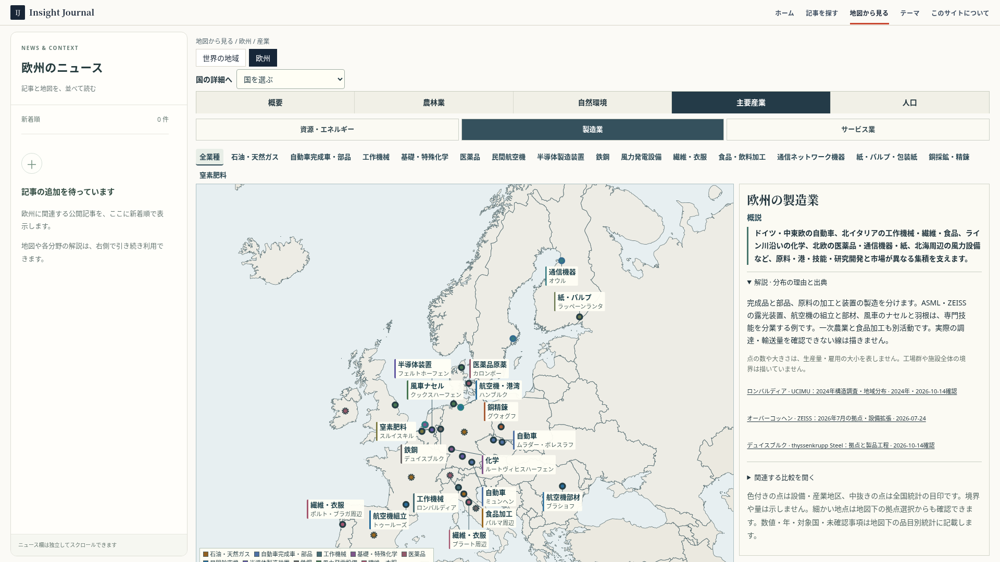
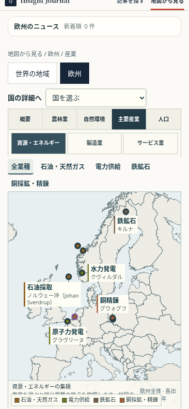

# 欧州主要産業の21品目実装・確認記録

2026-10-14。起点はmain 63e998cc（PR #351）。既存の欧州版とカナダの三分野・固定ラベル構成を確認。日本・世界産業地図・他地域・共通UIのファイルには変更を加えていない。独立ブランチで実装し、マージと公開は行わない。

## 調査提案との対応

本採用16品目と追加候補5品目を全て独立した選択肢・解説・統計として収録。計21品目、44の位置目印（既存30＋追加14）、48指標。石油精製と銅精錬は資源から製造への工程として両分野に掲載する。

| 提案 | 品目 | 主な分野 | 確認済みの地図目印ID |
| --- | --- | --- | --- |
| 本採用 | 石油・天然ガス | 資源・エネルギー | `johan`、`ormen`、`nyhamna`、`pernis` |
| 本採用 | 電力供給 | 資源・エネルギー | `kvilldal`、`gravelines` |
| 本採用 | 自動車完成車・部品 | 製造業 | `munich`、`mlada`、`kvasiny` |
| 本採用 | 工作機械 | 製造業 | `lombardy_tools` |
| 本採用 | 基礎・特殊化学 | 製造業 | `pernis`、`rotterdam`、`ludwigshafen` |
| 本採用 | 医薬品 | 製造業 | `kalundborg`、`ireland_pharma`、`swiss_pharma` |
| 本採用 | 民間航空機 | 製造業 | `toulouse`、`hamburg`、`brasov` |
| 本採用 | 半導体製造装置 | 製造業 | `veldhoven`、`oberkochen` |
| 本採用 | 鉄鋼 | 製造業 | `duisburg_steel`、`italy_steel` |
| 本採用 | 風力発電設備 | 製造業 | `cuxhaven_wind`、`aalborg_wind`、`hull_wind` |
| 本採用 | 繊維・衣服 | 製造業 | `portugal_textile`、`prato_textile` |
| 本採用 | 食品・飲料加工 | 製造業 | `parma_food`、`germany_food`、`france_food`、`spain_food` |
| 本採用 | 金融・保険 | サービス業 | `frankfurt`、`london_finance` |
| 本採用 | 観光 | サービス業 | `adriatic_tourism`、`tyrol_tourism` |
| 本採用 | 港湾・物流 | サービス業 | `rotterdam`、`hamburg` |
| 本採用 | ITサービス | サービス業 | `oulu`、`kista`、`wageningen_food`、`ireland_it` |
| 追加採用 | 通信ネットワーク機器 | 製造業 | `oulu`、`kista` |
| 追加採用 | 鉄鉱石 | 資源・エネルギー | `kiruna` |
| 追加採用 | 紙・パルプ・包装紙 | 製造業 | `kaukas` |
| 追加採用 | 銅採鉱・精錬 | 資源・エネルギー | `lubin`、`glogow` |
| 追加採用 | 窒素肥料 | 製造業 | `sluiskil_fertiliser` |

## 地図と数値の契約

- 地理の下地は既存の欧州45か国・SVG／MapLibreのまま。国境や森林面から産業生産の密度を推測していない。地図45か国、EU27、団体加盟地域、企業の世界事業を区別。キプロスのEU所属と地図上の文脈表示、ロシア全国のアジア側を明記する。
- 塗った点は施設・地区、中抜き点は全国統計の代表位置。追加7点は全国統計（アイルランドIT・医薬、スイス医薬、イタリア鉄鋼、ドイツ・フランス・スペイン食品）。実在しない工場を作っていない。
- 座標は施設・都市圏・地区・国の概略目印で敷地や集積境界ではない。HQ（本社）、研究、製造、採鉱、精製、輸出統計を本文で分ける。特定工場の生産を地域全体へ外挿していない。
- 線は既存のラベル対応線のみであり、推定輸送・貿易線は追加していない。容量、将来計画、実績を分ける。風車設備と発電、原薬と製剤、一次農業と食品加工も別工程。
- 産業名を上段、地名を補足にした固定ラベル。業種・拠点選択と単独表示はカメラを動かさない。ラベル配置は選択に依存せず、単独表示でも同分野の全点の場所を予約する。幅600px未満は固定の少数名称を使い、残る点は地図下の拠点選択でも読める。
- 右側は概説→理由・出典。品目別の規模・世界比・意味・限界は地図下。表は年、対象、分類・分母・単位、一次出典を併記し、狭い画面では表の内部だけ横スクロールできる。サービスに物品の需給式は適用しない。
- 旧分類URLは新分類へ移す。旧「自動車・機械」でASMLを保存していた場合は半導体装置へ復元し、不適合な分野の拠点は解除する。

## 数値を掲載する際の限界

EURATEXの基準年、Ericssonが引用するRAN（無線アクセス網）市場の元調査、窒素肥料の世界比の基準年は未確認として画面に残す。銅の世界生産分母・欧州窒素肥料の単独付加価値等は未取得。未取得を0としない。ASML・Vestas・Airbus・Ericsson・LKAB・KGHM・Yaraの世界売上を欧州国内GDPに転用しない。

対中自動車輸出はACEA原表18ページで、金額43.0%減・台数42.8%減と確認。2025年EU発電は速報、EU内原子力集中比は2024年、RTEのフランス本土発電は2025年として年・集合を維持する。詳細な48指標と出典URLは [industry-catalog.ts](../../../src/data/atlas/europe/industry-catalog.ts) に収録。

## 検証

- 全体単体テスト：1,349成功・3スキップ・失敗0（1,352件）。URL正規化の変更後は欧州単体テストを追加確認（220成功・2スキップ）、品目・拠点・製品段階の契約4件も成功。
- ビルド：schema／content validation／Astro／Pagefind成功。配信情報検証成功。
- 欧州E2E：47件成功・失敗0。
- PC 1920×1080：通常のMapLibreとSVGの三分野、全21品目の強調・単独表示・地点選択、矢印キー・Escape、リロード・戻る／進む、根拠表同期を確認。6ケース、10スクリーンショット。重なり・配置移動・地図フレーム変化・ページ例外なし。
- スマートフォン相当390×844、844×390：通常地図とSVGの三分野（12ケース）、全品目、単独表示、拠点選択を確認。名称は資源5・製造8・サービス6、ラベル重なり・枠外表示・ページ横はみ出し・選択時移動・ページ例外なし。実機iPadの確認ではない。
- ブラウザー確認はローカルChromiumとソフトウェアWebGL。公開環境での配信検証・マージ・公開は未実施。

機械可読の記録：[PC](desktop-checks.json)、[スマートフォン](responsive-checks.json)、[最終統計・表のキーボード操作](final-statistics-checks.json)。

